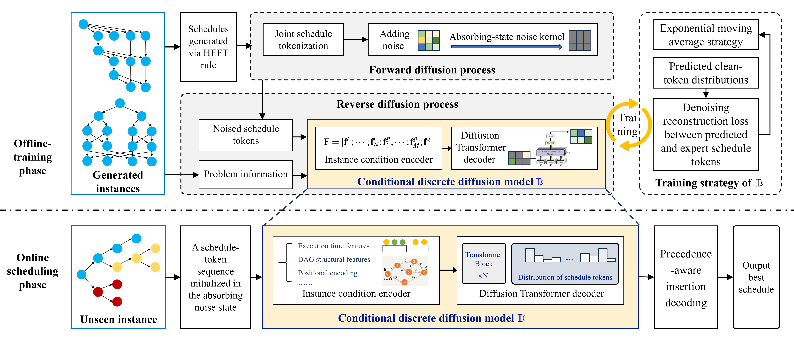
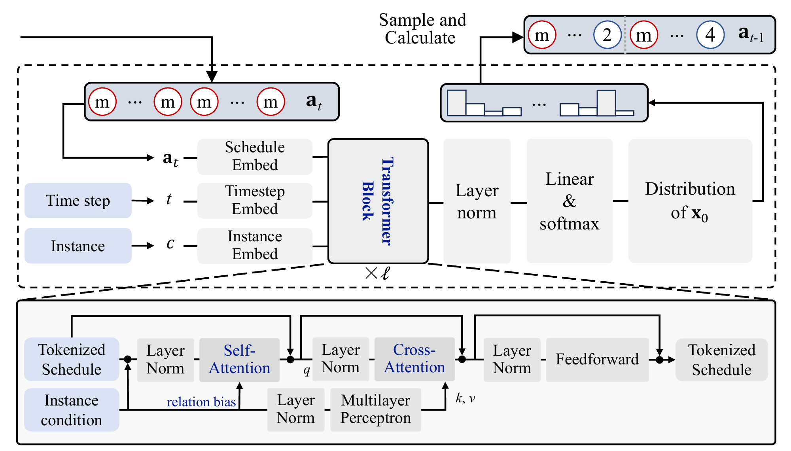
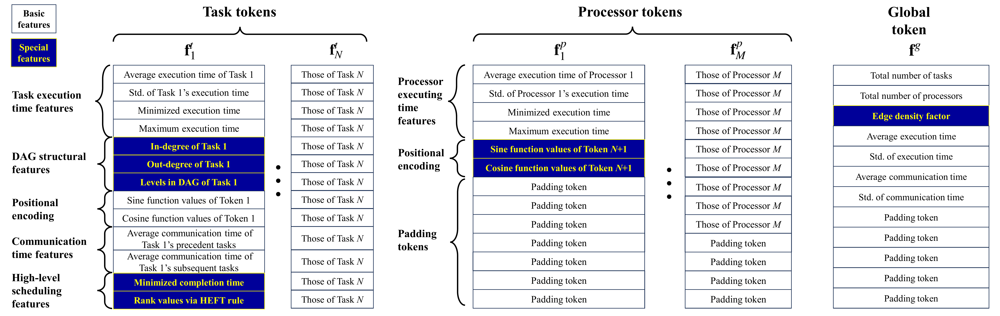
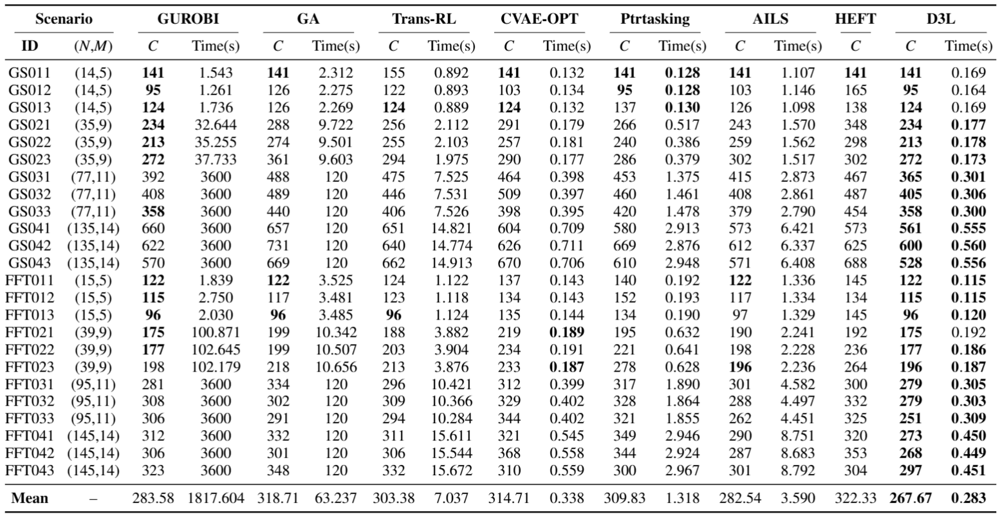

# D3L-DAG

D3L is a discrete diffusion-based framework for heterogeneous DAG scheduling, with instance generators, training and evaluation code, ablation studies, and baseline solvers.

## Figures





[Algorithm PDF](result/algorithm.pdf)



[Feature Design PDF](result/feature.pdf)

## Results

The table reports makespan (C) and solution time in seconds for D3L and the baseline methods across 24 GS and FFT scenarios.



## Data Generation

```bash
python -m data.hcps_dataset_heft_cmax --out datasets/dts5000
```

## Training and Evaluation

```bash
python -u -m core.train --data datasets/dts5000 --scale GS03 --out runs/GS03_d3l --device cuda
python -u -m eval.evaluate --checkpoint runs/GS03_d3l/best.pt --data datasets/dts5000 --out runs/GS03_d3l/test --device cuda
```
